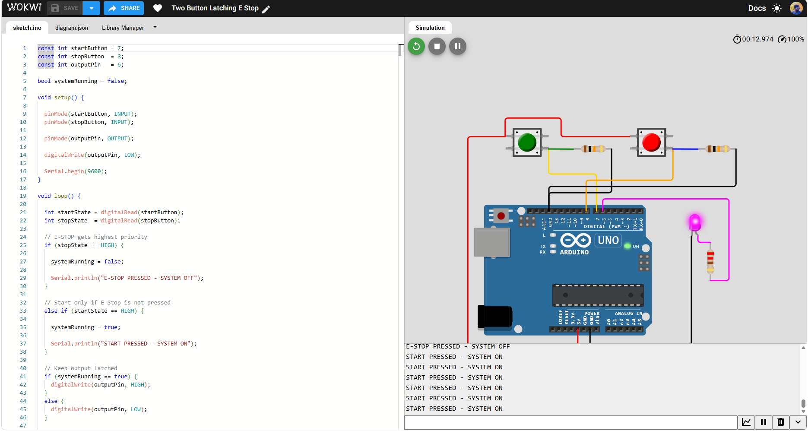
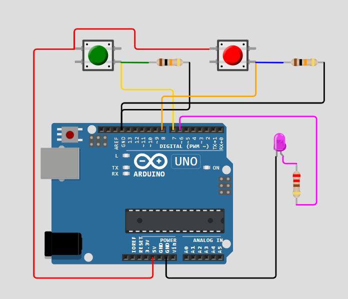
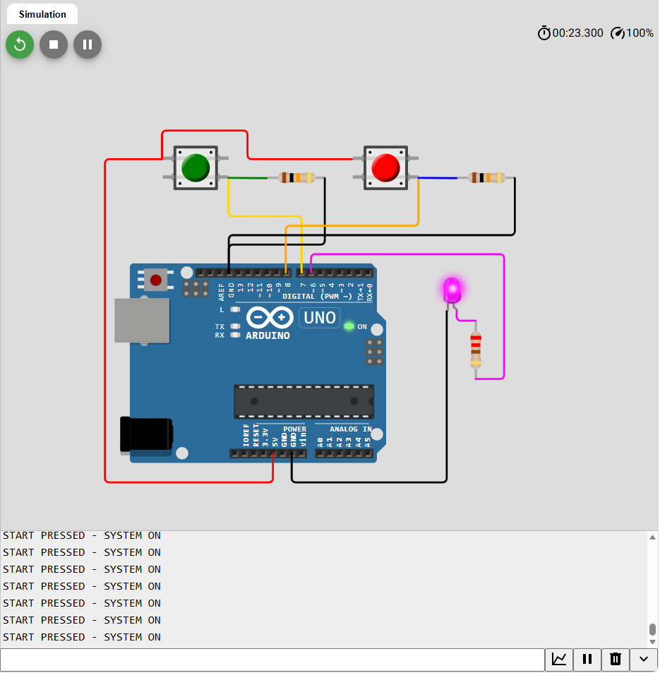

# Two-Button Latching Stop Controller



**Arduino UNO • START/STOP latch • stop-priority logic • Wokwi simulation**

A simple Arduino demonstration of two-button start/stop control with a latched digital output. Pressing **START** sets the output HIGH and keeps it HIGH after the button is released. Pressing **STOP** resets the output to LOW. If START and STOP are pressed together, **STOP wins**. The magenta LED indicates the output state, and the Serial Monitor reports button commands at 9600 baud.

> **Safety notice:** This is a software demonstration, **not** a real safety-rated emergency-stop system. An Arduino, momentary pushbutton, LED, and software latch must not be relied on to stop hazardous machinery. Real emergency stops require appropriate certified hardware, independently wired safety circuits, risk assessment, and safe reset behavior.

## Project files

| File / folder | Description |
|---|---|
| `sketch.ino` | Main Arduino sketch for Wokwi |
| `diagram.json` | Reconstructed Wokwi diagram with components and connections |
| `src/` | Additional copy of the Arduino program |
| `docs/` | Wiring, operation, testing and screenshots |
| `libraries.txt` | External library requirements (none) |
| `LICENSE` | MIT software license |

## Hardware (simulated)

- Arduino UNO R3 (1)
- Momentary pushbuttons: **START** (green) and **STOP** (red)
- 10 kΩ resistors (2), external pull-down resistors
- 220 Ω current-limiting resistor (1)
- LED (magenta, 1)
- Connection wires

## Pin assignments

| Arduino pin | Connection | Explanation |
|---|---|---|
| `D7` | START button signal | HIGH while pressed |
| `D8` | STOP button signal | HIGH while pressed |
| `D6` | LED through 220 Ω resistor | HIGH when latched ON |
| `5V` | One contact of each button | Press supplies HIGH |
| `GND` | Both 10 kΩ pull-down resistors and LED cathode | Common ground |

Each pushbutton signal uses a 10 kΩ resistor to GND so its unpressed input reads LOW. The pin names `1.l`, `1.r` and `2.l`, `2.r` follow the Wokwi pushbutton model (contact 1 is separate from contact 2 when released).

## Logic

```text
POWER ON -> output LOW
       |
       v
Read START (D7) and STOP (D8)
       |
       +-- STOP HIGH? -- YES --> running = false
       |
       +-- START HIGH? - YES --> running = true
       |
       +-- Neither? ---------> preserve running state
       |
       v
Write D6 = running; repeat after 20 ms
```

## How to run in Wokwi

1. Open [Wokwi](https://wokwi.com/) and create a new **Arduino Uno** project.
2. Replace the new project's `sketch.ino` with the `sketch.ino` from this folder.
3. Replace its `diagram.json` with the `diagram.json` from this folder.
4. Start the simulation and open the **Serial Monitor** at **9600 baud**.
5. Press green **START**: the LED turns ON and stays ON after release.
6. Press red **STOP**: the LED goes OFF and stays OFF after release.
7. Press both: the STOP branch has priority.

**Note:** The Wokwi diagram has been reconstructed from the supplied screenshots and source code, not exported from the original simulation. Inspect its wiring in the Wokwi editor before relying on it. The screenshots document the supplied original circuit.

## Expected behavior

| START | STOP | Latched state / D6 |
|---|---|---|
| Released | Released | Retains previous value |
| Pressed | Released | ON / HIGH |
| Released | Pressed | OFF / LOW |
| Pressed | Pressed | OFF / LOW (STOP priority) |

The serial output may print multiple messages while a button is held because the loop repeats every 20 ms. This is expected from the supplied code.

## Screenshots

**Circuit wiring**


**START pressed: output ON**


## Limitations and future improvements

- The demonstration uses a software latch only, not a hardware interlock.
- Inputs use external pull-down resistors; without them `INPUT` pins can float.
- The loop has no edge detection or debounce apart from the short delay.
- A real safety function needs a dedicated safety-rated stop device and circuit; do not implement it by extending this demonstration alone.

## Credits

Project documentation based on user-provided Arduino source and Wokwi screenshots (November 2026). `diagram.json` was recreated to match the depicted components and logic.
